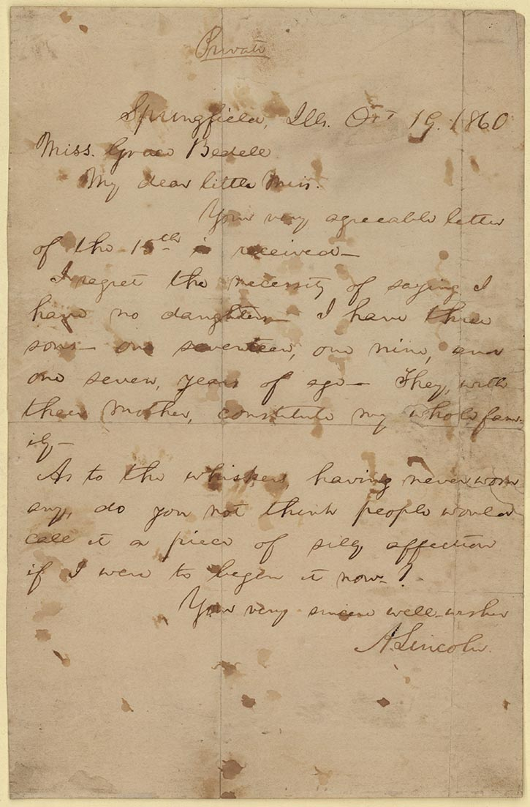

{::options parse_block_html="true" auto_ids="false" /}

<section id="examples" class="workshop-title supplement-index" aria-label="Optional handwriting examples">
<header>

Reliable AI for Humanists

<h1>Handwriting transcription</h1>

Examples to discuss

</header>

<a href="#/original">A faithful first pass</a>
<a href="#/one-word">One uncertain word</a>
<a href="#/second-reading">A second reading</a>
<a href="#/project-files">Saved project files</a>

<footer class="deck-source" markdown="0"></footer>
<aside class="notes" markdown="1">
Use these examples independently. Click a topic here or choose All slides. The prompt clinic uses slides 2–3; one-word discussion uses 4–5; second-reader comparison uses 6–7; the folder example is slide 8. Allow about eight minutes across all four topics.

The source is an 1860 letter by Abraham Lincoln, held by the Benjamin Shapell Family Manuscript Foundation and shown in a Library of Congress exhibition. A famous document may be familiar to a model. This is a demonstration of a checking procedure, not an accuracy benchmark. All reference readings and the deliberately altered comparison are prepared teaching examples, not recorded AI replies.

Cover art: Christoph Weigel, Der Schreiber (1698), National Library of Poland, public domain. Existing Reliable AI asset.
</aside>
</section>

<section id="original" class="workshop-example" aria-label="The original manuscript and selected paragraph">
<header>
The source
<h2>One letter, four lines</h2></header>

<figure class="full-manuscript"><figcaption>The complete page</figcaption></figure>

The final substantive paragraph

Abraham Lincoln to Grace Bedell October 19, 1860

Where would you check the assistant's reading?

<footer class="deck-source" markdown="0"><a href="https://www.loc.gov/exhibits/lincoln/candidate-lincoln.html#obj1">Library of Congress exhibition</a></footer>
<aside class="notes" markdown="1">
Show the page before asking for a transcription. Locate the final substantive paragraph, beginning “As to the whiskers” and ending “begin it now?”. Give the room time to locate it. The enlargement displays the same unaltered image through a closer view; it adds no generated strokes.

Source image: https://www.loc.gov/exhibits/lincoln/vignettes/CandidateLincoln/Assets/al0070_enlarge.jpg . Lender: Benjamin Shapell Family Manuscript Foundation. Letter content is public domain. Reference excerpt: https://www.loc.gov/exhibits/lincoln/ext/transcription20.html . The Library's excerpt covers this paragraph, not the entire page.
</aside>
</section>

<section id="faithful-draft" class="workshop-example" data-timing="120" aria-label="Requesting a faithful first pass">
<header>
The task brief
<h2>A faithful first pass</h2></header>



Request, with the image attached
<button class="prompt-copy" type="button" data-prompt-copy aria-label="Copy the first-pass prompt">Copy</button>
<pre class="prompt-text"><code>{{ example_prompt.text | strip | escape }}</code></pre>

Prepared reference reading

L01 As to the whiskers, having never worn

L02 any, do you not think people would

L03 call it a piece of silly affectation

L04 if I were to begin it now?

Line labels help us locate a reading in the image.

Which choices should the task brief make explicit?

<footer class="deck-source" markdown="0"><a href="https://www.loc.gov/exhibits/lincoln/ext/transcription20.html">Reference wording</a></footer>
<aside class="notes" markdown="1">
Allow two minutes for slides 2–3. Ask participants to identify original spelling, abbreviations, line breaks or uncertainty as a choice. Show that the prompt requests a transcription convention. The bracket notation is our exercise convention, not a universal standard. Numbered lines are added reference labels.

The displayed text is a prepared reading based on the image and Library of Congress excerpt. It is not a saved model reply. Check punctuation against the image where an exact diplomatic transcription is required. For a live demo, attach the original image, use this prompt and save the actual reply separately. A prompt describes desired behavior; try the result against the page to see whether the assistant followed it.

Smithsonian transcription guidance supports preserving original spelling, grammar and abbreviations and marking uncertainty, with its own notation and layout conventions: https://transcription.si.edu/instructions/transcribe .
</aside>
</section>

<section id="one-word" class="workshop-reading" data-timing="90" aria-label="Two possible readings of one word">
<header>
A word to inspect
<h2>Two readings of one word</h2></header>

Reading A<strong>affectation</strong>

Reading B<strong>affection</strong>

Prepared contrast: B deliberately changes one word.

What visible letters would support your choice?

<footer class="deck-source" markdown="0"><a href="https://www.loc.gov/exhibits/lincoln/vignettes/CandidateLincoln/Assets/al0070_enlarge.jpg">Original image</a></footer>
<aside class="notes" markdown="1">
Give the room 20 seconds to inspect the final word of the third line. Ask where the two proposed readings differ and what they can actually see. Context can suggest a reading but does not alone settle the handwriting. Reveal the Library's reference only after participants examine the image: https://www.loc.gov/exhibits/lincoln/ext/transcription20.html .

These are prepared teaching versions, not two model outputs. Version B deliberately replaces “affectation” with “affection”. Use an actual uncertain word instead when a live run gives you one. If a live result is correct, do not suggest it made this constructed error. The same manuscript image recurs so the room can inspect one passage through successive checks.
</aside>
</section>

<section id="word-followup" class="workshop-example" data-timing="90" aria-label="A prompt about one uncertain word">
<header>
A smaller follow-up
<h2>A question about one word</h2></header>



Request, with the original image
<button class="prompt-copy" type="button" data-prompt-copy aria-label="Copy the one-word prompt">Copy</button>
<pre class="prompt-text"><code>{{ example_prompt.text | strip | escape }}</code></pre>

<dl class="example-lines"><dt>Something to examine</dt><dd>A visible letter or a comparable form elsewhere in the same hand.</dd><dt>Something to keep open</dt><dd>A reading the image does not settle.</dd></dl>
Check the assistant's observations against the page.

What would help if this image cannot resolve the word?

<footer class="deck-source" markdown="0"></footer>
<aside class="notes" markdown="1">
Slides 4–5 take about three minutes together. Point to one letter the assistant describes and compare it with the image. An explanation of letter forms may itself be wrong. Ask for a better scan or another reader if the image does not support a decision. An unresolved result is useful when it accurately locates the remaining work.

The prompt narrows the task to one word. It requests observable evidence and alternatives, not private reasoning or numerical confidence. Use the same image and keep surrounding words available. This is a proposed prompt, not a claim that a particular model reliably follows it.
</aside>
</section>

<section id="second-reading" class="workshop-summary" data-timing="60" aria-label="Obtaining a second reading with the original image">
<header>
A second reader
<h2>The image goes to both readers</h2></header>

<ol><li>Give a fresh conversation the image and the same transcription brief.</li><li>Obtain its reading before sharing the first draft.</li><li>Compare the drafts and locate differences on the image.</li><li>Check an agreed passage too.</li></ol>

Agreement gives us another reading to inspect.

<footer class="deck-source" markdown="0"></footer>
<aside class="notes" markdown="1">
Use slides 6–7 for a two-minute checking intervention. The second reader needs the original image to check handwriting. A copy of the first reader's text allows text comparison but does not by itself provide visual evidence. Obtain a separate reading first, then compare. This procedure makes the comparison inspectable; it does not guarantee independence or correctness.

Ask the room to locate one disagreement and one agreement. Before quoting a passage or using a name, date or number as evidence, check that material directly against the source. Keep the first drafts and save the corrected result separately.
</aside>
</section>

<section id="comparison" class="workshop-example" data-timing="60" aria-label="A comparison table for review">
<header>
A comparison to review
<h2>Readings beside the image evidence</h2></header>



Supply the image and both drafts
<button class="prompt-copy" type="button" data-prompt-copy aria-label="Copy the comparison prompt">Copy</button>
<pre class="prompt-text"><code>{{ example_prompt.text | strip | escape }}</code></pre>

Prepared teaching comparison
<table class="reading-table"><thead><tr><th>Location</th><th>A</th><th>B</th></tr></thead><tbody><tr><th>L03</th><td>affectation</td><td>affection</td></tr><tr><th>L04</th><td>if I were</td><td>if I were</td></tr></tbody></table>
Inspect the extra letters in L03 and the agreed words in L04.

B contains a deliberate alteration.

Which decision can you support from the original?

<footer class="deck-source" markdown="0"><a href="https://www.loc.gov/exhibits/lincoln/vignettes/CandidateLincoln/Assets/al0070_enlarge.jpg">Original image</a></footer>
<aside class="notes" markdown="1">
This small table locates two places to inspect. A live response to the prompt should also describe image evidence and unresolved questions; do not introduce this table as that response. It is a prepared contrast. L03 is the deliberately altered word. L04 shows agreement, which still deserves a source check.

Read the comparison prompt as a whole; paste Reading A and Reading B after it and attach the original image. Ask attendees to give one decision and its basis in the image. Keep any unresolved alternatives visible. The proposed prompt requires human decisions before creating a separate checked transcription.
</aside>
</section>

<section id="project-files" class="workshop-example" data-timing="60" aria-label="Saving the source, drafts and checked transcription">
<header>
Continuing the work
<h2>Files for the next session</h2></header>

<pre class="file-tree">one-document/
  original.jpg
  instructions.txt
  draft-a.txt
  draft-b.txt
  checked-transcription.txt
  review-notes.csv</pre>

<dl class="example-lines"><dt>The drafts</dt><dd>Keep what each assistant returned.</dd><dt>The checked version</dt><dd>Save your chosen readings and retain unresolved words.</dd><dt>The review notes</dt><dd>Record the location, decision and basis in the image.</dd></dl>

A useful first task is one page you can check.

<footer class="deck-source" markdown="0"></footer>
<aside class="notes" markdown="1">
This is a suggested folder, not an inventory of a recorded run. Show an actual saved project if you have one. Review notes should describe checks and decisions that occurred. An unresolved word can remain in a checked transcript; state the extent of review accurately.

For search and exploration, a draft may help locate passages to inspect. Before quoting, check the complete quotation against the original. If the discussion turns to batches, distinguish scale from agency: Transkribus already allows selecting multiple pages or documents for recognition. An agent can coordinate additional steps. Source: https://help.transkribus.org/automatically-transcribing-your-documents .
</aside>
</section>
